 

I work where digital logic meets real hardware — **designing FPGA logic in VHDL, building automated test equipment, and finding out why hardware fails**. I spent three and a half years as a navigation & GNSS specialist, developing FPGA logic and VHDL / Python automation. 

Off the clock I keep building: multi-agent AI systems, productivity tools, and games in Unreal Engine and Blender.

 

 

### Tools

**HDL & FPGA** 
        

**Software** 
  

**Test & domain** 
   

**3D & games** 
 

### Selected work

<table>
<tr>
<td width="33%" valign="top">

**[Avionics UUT Tester](https://github.com/OfirSipp/Avionics-UUT-Tester)** 
Automatic test equipment for a legacy avionics audio-warning unit — my 2022 diploma project, re-implemented in 2026. Alert-tone recognition runs in VHDL on the FPGA fabric, the Zynq's ARM core drives the test procedure over AXI, and a custom relay / ADC / DAC board connects to the unit under test.

`VHDL-2008` `Zynq-7020` `AXI` `bare-metal C` `ILA`

</td>
<td width="33%" valign="top">

**[Gate Tasks](https://github.com/OfirSipp/Gate-Tasks)** 
A task manager for a multi-person office, with a separate board for every person on the team.

`Python` `team tooling`

</td>
<td width="33%" valign="top">

**Game projects** 
Personal games built in Unreal Engine, with models and assets made in Blender.

`Unreal Engine` `Blender`

</td>
</tr>
</table>

 

Every graphic here is hand-written SVG + SMIL, generated by the scripts in this repo. The waveform carries a real 8N1 UART stream — the bits on screen actually spell the message — and the activity trace is re-rendered daily by GitHub Actions.
